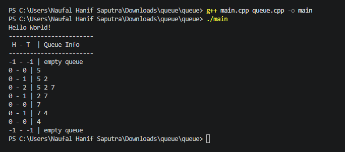
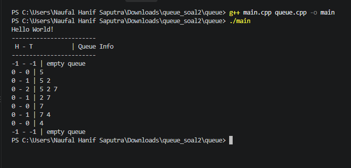
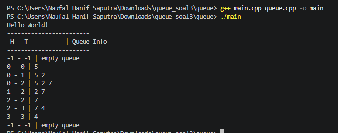

# <h1 align="center">Laporan Praktikum Modul 8 QUEUE</h1>
<p align="center">Naufal Hanif Saputra - 109082500209</p>

## Dasar Teori 
Queue adalah struktur data linear yang bekerja dengan aturan FIFO (First In, First Out): elemen yang lebih dulu dimasukkan akan lebih dulu dikeluarkan. Setiap queue punya dua penanda posisi, yaitu head yang menunjuk elemen terdepan dan tail yang menunjuk elemen terakhir. Pada tingkat ADT (Abstract Data Type), operasi yang umum tersedia meliputi enQueue (menambah elemen di belakang), deQueue (mengambil elemen dari depan), isEmpty (cek apakah kosong), isFull (cek apakah penuh), dan viewQueue (menampilkan seluruh isi). Queue bisa dibangun dengan Array ataupun Linked List. Jika memakai Array, ada tiga cara kerja: Alternatif 1, head selalu diam di indeks awal sementara tail bergerak dan elemen digeser saat ada penghapusan; Alternatif 2, head dan tail sama-sama bergerak sehingga tidak ada pergeseran elemen; Alternatif 3, Circular Queue, di mana posisi head dan tail berputar kembali ke awal sehingga slot kosong bisa dipakai lagi. Jika memakai Linked List, data disimpan dalam node yang dihubungkan pointer next, dengan head di node pertama dan tail di node terakhir. Contoh penerapan queue sehari-hari antara lain antrean di kasir, antrean kendaraan, dan daftar tunggu cetak dokumen. Lewat praktikum ini diharapkan konsep FIFO, peran head dan tail, serta proses tambah-hapus data pada Array maupun Linked List dengan C++ dapat dipahami dengan baik.
## Guided 
 
### Modul 8(1)
### 1. queue.h

```C++
#ifndef QUEUE_H_INCLUDE 
#define QUEUE_H_INCLUDE

#include <iostream>
using namespace std;

#define Nil NULL  

typedef bool boolean;
typedef int infotype;
typedef struct elmQ *address;  

struct elmQ{  
    infotype info;  
    address next; 
}; 

struct queue {  
    address head, tail; 
}; 

boolean isEmpty(queue Q); 
void CreateQueue(queue &Q); 
address alokasi(infotype X); 
void dealokasi(address P); 
address findElm(queue Q, infotype X); 
boolean fFindElm(queue Q, address P); 
void insert(queue &Q, address P); 
void deletequeue(queue &Q, address &P); 
void printInfo(queue Q); 
int nbList(queue Q); 
void delAll(queue &Q); 

#endif 
```

### 2. queue.cpp

```C++
#include "queue.h"

boolean isEmpty(queue Q) {
    return (Q.head == Nil);
}

void CreateQueue(queue &Q) {
    Q.head = Nil;
    Q.tail = Nil;
}

address alokasi(infotype X) {
    address P = new (nothrow) elmQ;
    if (P != Nil) {
        P->info = X;
        P->next = Nil;
    }
    return P;
}

void dealokasi(address P) {
    delete P;
}

address findElm(queue Q, infotype X) {
    address P = Q.head;
    while (P != Nil) {
        if (P->info == X) {
            return P;
        }
        P = P->next;
    }
    return Nil;
}

boolean fFindElm(queue Q, address P) {
    address R = Q.head;
    while (R != Nil) {
        if (R == P) {
            return true;
        }
        R = R->next;
    }
    return false;
}

void insert(queue &Q, address P) {
    if (isEmpty(Q)) {
        Q.head = P;
        Q.tail = P;
    } else {
        (Q.tail)->next = P;
        Q.tail = P;
    }
}

void deleteQueue(queue &Q, address &P) {
    P = Q.head;
    if (Q.head == Q.tail) {
        Q.head = Nil;
        Q.tail = Nil;
    } else {
        Q.head = P->next;
    }
    P->next = Nil;
}

void printInfo(queue Q) {
    if (isEmpty(Q)) {
        cout << "Queue kosong" << endl;
    } else {
        address P = Q.head;
        while (P != Nil) {
            cout << P->info << " ";
            P = P->next;
        }
        cout << endl;
    }
}

int nbList(queue Q) {
    int jumlah = 0;
    address P = Q.head;
    while (P != Nil) {
        jumlah++;
        P = P->next;
    }
    return jumlah;
}

void delAll(queue &Q) {
    address P;
    while (!isEmpty(Q)) {
        deleteQueue(Q, P);
        dealokasi(P);
    }
}
```

### 3. main.cpp

```C++
#include <iostream>
#include "queue.h"
using namespace std;

int main() {
    queue Q;
    address P;

    CreateQueue(Q);
    cout << "isEmpty : " << isEmpty(Q) << endl;
    printInfo(Q);

    insert(Q, alokasi(5));
    insert(Q, alokasi(2));
    insert(Q, alokasi(7));
    cout << "Setelah insert 5, 2, 7 " << endl;
    printInfo(Q);
    cout << "nbList : " << nbList(Q) << endl; 

    P = findElm(Q, 2);
    if (P != Nil) {
        cout << "findElm(2) ketemu, info = " << P->info << endl;
        cout << "fFindElm :" << fFindElm(Q, P) << endl;
    }
    if (findElm(Q, 9) == Nil) {
        cout << "findElm(9) tidak ketemu" << endl;
    }

    deletequeue(Q, P);
    cout << "Setelah delete, elemen yang keluar = " << P->info << endl;
    dealokasi(P);
    printInfo(Q);

    delAll(Q);
    cout << "Setelah delAll" << endl;
    printInfo(Q);
    cout << "isEmpty : " << isEmpty(Q) << endl;

    return 0;
}
```
penjelasan Pada Modul 8(1), queue dibuat dengan Linked List dan tetap mengikuti aturan FIFO. Tiap data ditempatkan dalam sebuah node yang menyimpan nilai (info) dan alamat node berikutnya (next), sementara head dan tail menandai node paling depan dan paling belakang. Operasi yang disediakan mencakup insert untuk menambah node di belakang, deleteQueue untuk melepas node terdepan, findElm dan fFindElm untuk mencari data atau alamat, nbList untuk menghitung jumlah node, serta delAll untuk mengosongkan seluruh queue dan melepas memorinya. Karena node dialokasikan satu per satu secara dinamis, ukuran queue tidak dibatasi oleh kapasitas tetap seperti pada array, selama memori masih cukup.

### Modul 8(2)

### queue.h

```C++
#ifndef QUEUE_H
#define QUEUE_H

#include <iostream>
using namespace std;

const int MAKSIMAL = 5;

struct queue {
    string nama[MAKSIMAL];
    int head;
    int tail;
};

bool isFull(queue Q);
bool isEmpty(queue Q);
void CreateQueue(queue &Q);
void enQueue(queue &Q, string nama);
void deQueue(queue &Q);
void viewQueue(queue Q);

#endif
```

### queue.cpp
```C++
#include "queue.h"
#include <iostream>

using namespace std;

// NOTE : 
// Implementasi 1 = head diam, tail bergerak (Queue Linear Statis, kerana head nya tetap diam)
// Implementasi 2 = head bergerak, tail bergerak (Queue Linear Dinamis, karena head & tail nya sama-sama bergerak)
// Implementasi 3 = head dan tail berputar (Queue Circular, karena jika udh mentok tapi masih ada space, diputar sehingga tail bisa ada didepan head)

bool isEmpty(queue Q){
    if(Q.head == -1 && Q.tail == -1){
        return true;
    } else {
        return false;
    }
}

//isFull implmenetasi 1 & 2
bool isFull(queue Q){
    if(Q.tail == MAKSIMAL - 1){
        return true;
    } else {
        return false;
    }
}

// //isFull implementasi 3
// bool isFull(queue Q){
//     if((Q.tail + 1) % MAKSIMAL == Q.head){
//         return true;
//     } else {
//         return false;
//     }
// }

void CreateQueue(queue &Q){ //terbentuk queue dengan head = -1 dan tail = -1 
    Q.head = -1;
    Q.tail = -1;
}
 

//enqueue implementasi 1 & 2
void enQueue(queue &Q, string nama){
    if(isFull(Q) == true){
        cout << "Queue sudah penuh!" << endl;
    } else {
        if(isEmpty(Q) == true){
            Q.head = Q.tail = 0;
        } else {
            Q.tail++;
        }
        Q.nama[Q.tail] = nama;
        cout << "nama " << nama << " berhasil ditambahkan kedalam queue!" << endl;
    }
}

// //enQueue implementasi 3
// void enQueue(queue &Q, string nama){
//     if(isFull(Q) == true){
//         cout << "Queue sudah penuh!" << endl;
//     } else {
//         if(isEmpty(Q) == true){
//             Q.head = Q.tail = 0;
//         } else {
//             Q.tail = (Q.tail + 1) % MAKSIMAL; // bergerak melingkar
//         }
//         Q.nama[Q.tail] = nama;
//         cout << "nama " << nama << " berhasil ditambahkan kedalam queue!" << endl;
//     }
// }

//dequeue implementasi 1
void deQueue(queue &Q){
    if(isEmpty(Q) == true){
        cout << "Queue kosong!" << endl;
    } else {
        cout << "Mengahapus data " << Q.nama[Q.head] << "..." << endl;
        for(int i = 0; i < Q.tail; i++){
            Q.nama[i] =  Q.nama[i+1];
        }
        Q.tail--;
        if(Q.tail < 0){ //kalo semua isi queue nya udh dikelaurin, set head & tail ke -1
            Q.head = -1;
            Q.tail = -1;
        }
    }
}

// //dequeue implementasi 2
// void deQueue(queue &Q){
//     if(isEmpty(Q) == true){
//         cout << "Queue kosong!" << endl;
//     } else {
//         cout << "Mengahapus data " << Q.nama[Q.head] << "..." << endl;
//         Q.head++;
//         if(Q.head > Q.tail){ //kalo elemennya udh abis (head akan lebih 1 dari tail), maka reset ulang head & tail ke -1
//             Q.head = -1;
//             Q.tail = -1;
//         }
//     }
// }

// //deQueue implementasi 3
// void deQueue(queue &Q){
//     if(isEmpty(Q) == true){
//         cout << "Queue kosong!" << endl;
//     } else {
//         cout << "Mengahapus data " << Q.nama[Q.head] << "..." << endl;
//         if(Q.head == Q.tail){ //kalo elemennya tinggal 1, langsungkan saja head & tail nya reset ke -1
//             Q.head = -1;
//             Q.tail = -1;
//         } else {
//             Q.head = (Q.head + 1) % MAKSIMAL; // bergerak melingkar
//         }
//     }
// }

//viewQueue implementasi 1 & 2
void viewQueue(queue Q){
    if(isEmpty(Q) == true){
        cout << "Queue kosong!" << endl;
    } else {
        for(int i = Q.head; i <= Q.tail; i++){
            cout << i -  Q.head + 1 << ". " << Q.nama[i] << endl;
        }
    }
    cout << endl;
}

// //viewQueue implementasi 3
// void viewQueue(queue Q){
//     if(isEmpty(Q) == true){
//         cout << "Queue kosong!" << endl;
//     } else {
//         int i = Q.head;
//         int count = 1;
//         while(true){
//             cout << count << ". " << Q.nama[i] << endl;
//             if(i == Q.tail){
//                 break;
//             }
//             i = (i + 1) % MAKSIMAL;
//             count++;
//         }   
//     }
// }
```

### main.cpp
```C++
#include "queue.h"
#include <iostream>

using namespace std;

int main(){
    queue Q;

    CreateQueue(Q);
    enQueue(Q, "Dimas");
    enQueue(Q, "Arvin");
    enQueue(Q, "Rizal");
    enQueue(Q, "Hafizh");
    enQueue(Q, "Fathur");
    enQueue(Q, "Daffa");
    cout << endl;

    cout << "--- Isi Queue Setelah enQueue ---" << endl;
    viewQueue(Q);
    cout << endl;

    deQueue(Q);
    deQueue(Q);
    deQueue(Q);
    deQueue(Q);
    // deQueue(Q);
    // deQueue(Q);
    cout << endl;

    cout << "--- Isi Queue Setelah deQueue ---" << endl;
    viewQueue(Q);

    return 0;
}
```
penjelasan Modul 8(2) memperlihatkan queue berbasis Array yang menyimpan data bertipe string (nama) dengan kapasitas maksimal 5 elemen. Urutan keluar data mengikuti FIFO, jadi nama yang pertama kali di-enQueue akan menjadi yang pertama dihapus oleh deQueue. Fungsi isEmpty dan isFull dipakai untuk memastikan operasi aman dilakukan, sedangkan viewQueue menampilkan isi antrean dari depan ke belakang. Pada main, enQueue yang keenam ("Daffa") ditolak karena queue sudah penuh, sehingga terlihat jelas pengaruh batas kapasitas. Contoh ini juga menunjukkan bagaimana nilai head dan tail berubah setiap kali data masuk atau keluar.

### Unguided 

### 1. soal 1

### queue.h

```C++

#ifndef QUEUE_H
#define QUEUE_H

typedef int infotype;

struct Queue {
    infotype info[5];
    int head, tail;
};

void createQueue(Queue &Q);
bool isEmptyQueue(Queue Q);
bool isFullQueue(Queue Q);
void enqueue(Queue &Q, infotype x);
infotype dequeue(Queue &Q);
void printInfo(Queue Q);

#endif
```

### queue.cpp
```C++

#include <iostream>
#include "Queue.h"
using namespace std;

void createQueue(Queue &Q) {
    Q.head = -1;
    Q.tail = -1;
}

bool isEmptyQueue(Queue Q) {
    return Q.head == -1 && Q.tail == -1;
}

bool isFullQueue(Queue Q) {
    return Q.tail == 4;
}

void enqueue(Queue &Q, infotype x) {
    if (!isFullQueue(Q)) {
        if (isEmptyQueue(Q)) {
            Q.head = 0;
            Q.tail = 0;
        } else {
            Q.tail++;
        }

        Q.info[Q.tail] = x;
    }
}

infotype dequeue(Queue &Q) {
    infotype x;

    if (!isEmptyQueue(Q)) {
        x = Q.info[Q.head];

        if (Q.head == Q.tail) {
            Q.head = -1;
            Q.tail = -1;
        } else {
            for (int i = 0; i < Q.tail; i++) {
                Q.info[i] = Q.info[i + 1];
            }
            Q.tail--;
        }

        return x;
    }

    return -1;
}

void printInfo(Queue Q) {
    if (isEmptyQueue(Q)) {
        cout << "-1 - -1 | empty queue" << endl;
    } else {
        cout << Q.head << " - " << Q.tail << " | ";

        for (int i = Q.head; i <= Q.tail; i++) {
            cout << Q.info[i] << " ";
        }

        cout << endl;
    }
}
```

### main.cpp
```C++

#include <iostream>
#include "queue.h"
using namespace std;

int main() {
    cout << "Hello World!" << endl;

    Queue Q;
    createQueue(Q);

    cout << "------------------------" << endl;
    cout << " H - T  | Queue Info" << endl;
    cout << "------------------------" << endl;

    printInfo(Q);

    enqueue(Q, 5);
    printInfo(Q);

    enqueue(Q, 2);
    printInfo(Q);

    enqueue(Q, 7);
    printInfo(Q);

    dequeue(Q);
    printInfo(Q);

    dequeue(Q);
    printInfo(Q);

    enqueue(Q, 4);
    printInfo(Q);

    dequeue(Q);
    printInfo(Q);

    dequeue(Q);
    printInfo(Q);

    return 0;
}
```
### Output Unguided 1 :

##### Output 1



penjelasan unguided 1 Soal 1 memakai Alternatif 1: head selalu berada di indeks 0 selama queue berisi, dan hanya tail yang berubah mengikuti banyaknya elemen. Setiap kali dequeue dijalankan, semua elemen sisa digeser satu langkah ke kiri supaya elemen terdepan tetap berada di indeks 0, lalu tail dikurangi satu. Akibatnya nilai head pada output selalu 0. Kekurangannya, proses penggeseran memerlukan perulangan sehingga lebih lambat jika elemennya banyak.

### 2. soal 2

### queue.h

```C++

#ifndef QUEUE_H
#define QUEUE_H

typedef int infotype;

struct Queue {
    infotype info[5];
    int head, tail;
};

void createQueue(Queue &Q);
bool isEmptyQueue(Queue Q);
bool isFullQueue(Queue Q);
void enqueue(Queue &Q, infotype x);
infotype dequeue(Queue &Q);
void printInfo(Queue Q);

#endif
```

### queue.cpp
```C++

#include <iostream>
#include "Queue.h"
using namespace std;

void createQueue(Queue &Q) {
    Q.head = -1;
    Q.tail = -1;
}

bool isEmptyQueue(Queue Q) {
    return Q.head == -1 && Q.tail == -1;
}

bool isFullQueue(Queue Q) {
    return Q.tail == 4;
}

void enqueue(Queue &Q, infotype x) {
    if (!isFullQueue(Q)) {
        if (isEmptyQueue(Q)) {
            Q.head = 0;
            Q.tail = 0;
        } else {
            Q.tail++;
        }

        Q.info[Q.tail] = x;
    }
}

infotype dequeue(Queue &Q) {
    if (isEmptyQueue(Q)) {
        return -1;
    }

    infotype x = Q.info[Q.head];

    if (Q.head == Q.tail) {
        Q.head = -1;
        Q.tail = -1;
    } else {
        for (int i = 0; i < Q.tail; i++) {
            Q.info[i] = Q.info[i + 1];
        }
        Q.tail--;
    }

    return x;
}

void printInfo(Queue Q) {
    if (isEmptyQueue(Q)) {
        cout << "-1 - -1 | empty queue" << endl;
    } else {
        cout << Q.head << " - " << Q.tail << " | ";

        for (int i = Q.head; i <= Q.tail; i++) {
            cout << Q.info[i] << " ";
        }

        cout << endl;
    }
}
```

### main.cpp
```C++

#include <iostream>
#include "queue.h"
using namespace std;

int main() {
    cout << "Hello World!" << endl;

    Queue Q;
    createQueue(Q);

    cout << "------------------------" << endl;
    cout << " H - T  \t | Queue Info" << endl;
    cout << "------------------------" << endl;

    printInfo(Q);

    enqueue(Q, 5);
    printInfo(Q);

    enqueue(Q, 2);
    printInfo(Q);

    enqueue(Q, 7);
    printInfo(Q);

    dequeue(Q);
    printInfo(Q);

    dequeue(Q);
    printInfo(Q);

    enqueue(Q, 4);
    printInfo(Q);

    dequeue(Q);
    printInfo(Q);

    dequeue(Q);
    printInfo(Q);

    return 0;
}
```
### Output Unguided 2 :

##### Output 1



penjelasan unguided 2 Soal 2 memakai Alternatif 2: head dan tail sama-sama dapat berpindah. Saat dequeue, head cukup dimajukan satu indeks tanpa memindahkan elemen lain, sehingga prosesnya lebih ringan dibanding Alternatif 1. Kelemahannya, slot di bagian depan array yang sudah ditinggalkan head tidak bisa dipakai lagi sampai queue benar-benar kosong, sehingga queue bisa dianggap penuh padahal masih ada ruang kosong di depan.
### 3. soal 3

### queue.h

```C++

#ifndef QUEUE_H
#define QUEUE_H

typedef int infotype;

struct Queue {
    infotype info[5];
    int head, tail;
};

void createQueue(Queue &Q);
bool isEmptyQueue(Queue Q);
bool isFullQueue(Queue Q);
void enqueue(Queue &Q, infotype x);
infotype dequeue(Queue &Q);
void printInfo(Queue Q);

#endif
```

### queue.cpp
```C++
#include <iostream>
#include "Queue.h"
using namespace std;

void createQueue(Queue &Q) {
    Q.head = -1;
    Q.tail = -1;
}

bool isEmptyQueue(Queue Q) {
    return Q.head == -1 && Q.tail == -1;
}

bool isFullQueue(Queue Q) {
    return (Q.tail + 1) % 5 == Q.head;
}

void enqueue(Queue &Q, infotype x) {
    if (!isFullQueue(Q)) {
        if (isEmptyQueue(Q)) {
            Q.head = 0;
            Q.tail = 0;
        } else {
            Q.tail = (Q.tail + 1) % 5;
        }

        Q.info[Q.tail] = x;
    }
}

infotype dequeue(Queue &Q) {
    if (isEmptyQueue(Q)) {
        return -1;
    }

    infotype x = Q.info[Q.head];

    if (Q.head == Q.tail) {
        Q.head = -1;
        Q.tail = -1;
    } else {
        Q.head = (Q.head + 1) % 5;
    }

    return x;
}

void printInfo(Queue Q) {
    if (isEmptyQueue(Q)) {
        cout << "-1 - -1 | empty queue" << endl;
    } else {
        cout << Q.head << " - " << Q.tail << " | ";

        int i = Q.head;

        while (true) {
            cout << Q.info[i] << " ";

            if (i == Q.tail) {
                break;
            }

            i = (i + 1) % 5;
        }

        cout << endl;
    }
}
```

### main.cpp
```C++

#include <iostream>
#include "queue.h"
using namespace std;

int main() {
    cout << "Hello World!" << endl;

    Queue Q;
    createQueue(Q);

    cout << "------------------------" << endl;
    cout << " H - T  \t | Queue Info" << endl;
    cout << "------------------------" << endl;

    printInfo(Q);

    enqueue(Q, 5);
    printInfo(Q);

    enqueue(Q, 2);
    printInfo(Q);

    enqueue(Q, 7);
    printInfo(Q);

    dequeue(Q);
    printInfo(Q);

    dequeue(Q);
    printInfo(Q);

    enqueue(Q, 4);
    printInfo(Q);

    dequeue(Q);
    printInfo(Q);

    dequeue(Q);
    printInfo(Q);

    return 0;
}
```

### Output Unguided 3 :

##### Output 1


penjelasan unguided 3 Soal 3 memakai Alternatif 3, yaitu Circular Queue. Posisi head dan tail dimajukan dengan operasi modulo ukuran array, sehingga setelah melewati indeks terakhir keduanya kembali ke indeks 0. Dengan begitu slot kosong di depan yang ditinggalkan head dapat dipakai kembali oleh tail, dan kapasitas array termanfaatkan lebih efisien. Queue dinyatakan penuh jika posisi setelah tail sama dengan head, dan kosong jika keduanya bernilai -1.

## Kesimpulan
Dari praktikum ADT Queue berbasis Array dengan tiga alternatif ini dapat disimpulkan bahwa queue bekerja dengan prinsip FIFO, yaitu data yang masuk lebih awal keluar lebih awal. Perbedaan ketiga alternatif terletak pada cara mengatur head dan tail. Alternatif 1 menjaga head tetap di indeks awal dengan konsekuensi elemen harus digeser setiap dequeue. Alternatif 2 menggerakkan head dan tail tanpa penggeseran, namun slot kosong di depan tidak bisa dimanfaatkan kembali sebelum queue kosong. Alternatif 3 (Circular Queue) membuat head dan tail berputar ke indeks awal sehingga slot kosong dapat dipakai ulang dan penggunaan array paling efisien.

## Referensi
[1] 1. OpenDSA. (n.d.). Queues. Virginia Tech. OpenDSA – Queue.<br>
[2] cppreference.com. (n.d.). std::queue. C++ Reference – std::queue.<br>
[3] Goodrich, M. T., Tamassia, R., & Goldwasser, M. H. (2014). Data Structures and Algorithms in Java (6th ed.). Wiley.<br>
[4] Klukowska, J. (n.d.). Abstract Data Types: Lists, Stacks and Queues. New York University. Materi Kuliah NYU.<br>
